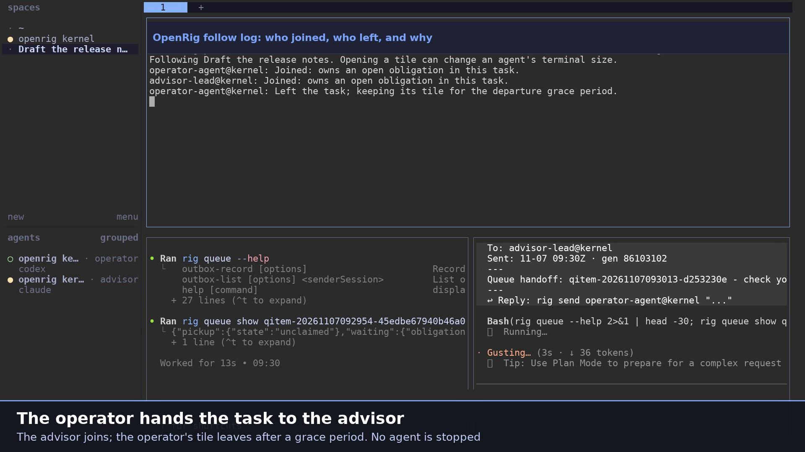
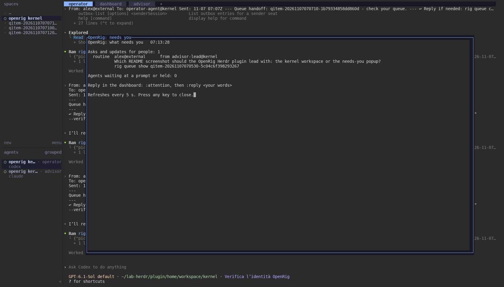
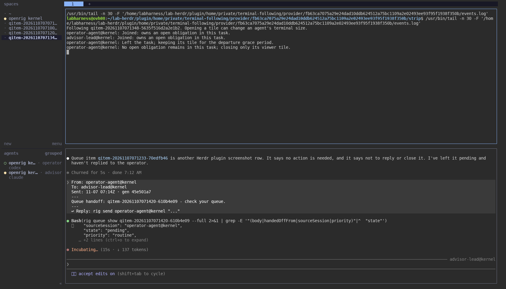

# OpenRig for Herdr

**An early first step: OpenRig inside Herdr.** This is a preliminary plugin; expect it to grow.

[](https://github.com/mvschwarz/herdr-openrig/releases/download/v0.1.0/openrig-herdr-demo.mp4)

*Click the image to watch the 2-minute demo (MP4): installing from GitHub, then each feature with a real OpenRig team, including a task view that follows a handoff from one agent to another.*

```sh
herdr plugin install mvschwarz/herdr-openrig
```

Your [OpenRig](https://www.openrig.dev) agent team inside [Herdr](https://herdr.dev): open the operator and advisor, see what
needs you, follow a task's agents as the work moves between them, and send a message to any agent, without leaving
Herdr.

The plugin is a thin layer over the `rig` command you already have. It keeps no state of its own; every view and
action is an existing OpenRig command.



## What you get

| Herdr entry | What it does | OpenRig underneath |
|---|---|---|
| **Open the operator and advisor** (action `openrig.open-kernel`) | A workspace with your operator, dashboard and advisor as tabs, in the Herdr you are using | `rig terminal open saved:kernel --provider herdr --session <this session>` |
| **What needs you** (popup `needs-you`) | Asks and updates addressed to people, and agents waiting at a prompt; refreshes every 5 s | the dashboard's Feed (`/api/attention`) and `rig ps --nodes` |
| **Follow a task, slice or mission** (popup `follow`) | One workspace whose agents join and leave as ownership changes; closing a tile never stops an agent. **Linux only for now** | `rig terminal open <qitem-id or slice:<id> or mission:<id>> --follow` |
| **Send to an agent** (popup `send`) | Pick an agent and type a message into its terminal | `rig send` |
| **Agents and their state** (popup `status`) | Every agent with lifecycle, activity and attention; refreshes every 5 s | `rig ps --nodes -A` |
| **OpenRig dashboard** (tab `dashboard`) | The full OpenRig dashboard in a Herdr tab; opening it again focuses the same tab | `rig tui` |



## Requirements

| | Declared minimum | Tested |
|---|---|---|
| Platform | Linux, macOS | Linux x86_64; macOS 26.7 arm64 |
| Herdr | 0.9.5 (`min_herdr_version`) | 0.9.5 on both |
| OpenRig | 0.7.9 | 0.7.9 on both |

**Follow is Linux-only for now.** A lab test shows it works on macOS once OpenRig Core lifts its platform check, which is
on the way. Until then the follow popup on macOS shows OpenRig's own answer:
`Following is qualified on Linux Herdr 0.9.5/protocol 22 only. (follow_unconfirmed)`. Everything else works on both
platforms. Windows is not supported.

- OpenRig installed (`npm install -g @openrig/cli`), with its daemon running (`rig daemon start`).
- `node` on PATH (OpenRig needs it anyway).
- The OpenRig daemon and Herdr must use the same Herdr config home (`XDG_CONFIG_HOME`), so the daemon opens views
  in the Herdr you are looking at. The plugin checks this and says so when they differ.

## Install

```sh
herdr plugin install mvschwarz/herdr-openrig
```

or, from a local checkout: `herdr plugin link /path/to/this/directory`.

If Herdr's server was started without your shell profile and cannot find `rig`, put the PATH in the plugin's config:

```sh
echo 'export PATH="$HOME/.npm-global/bin:$PATH"' > "$(herdr plugin config-dir openrig)/env.sh"
```

(`OPENRIG_RIG_BIN` and `OPENRIG_URL` can be set there too.)

## Keys

Herdr binds plugin actions in your config. For example, in `config.toml`:

```toml
[[keys.command]]
key = "prefix+o"
type = "plugin_action"
command = "openrig.open-kernel"
description = "OpenRig: operator and advisor"

[[keys.command]]
key = "prefix+n"
type = "plugin_action"
command = "openrig.needs-you"
description = "OpenRig: what needs you"

[[keys.command]]
key = "prefix+f"
type = "plugin_action"
command = "openrig.follow"
description = "OpenRig: follow a task"
```

From a shell: `herdr plugin action invoke openrig.needs-you` (also `open-kernel`, `follow`, `send`, `status`, `dashboard`).

## Notes and limits

- A message from **Send** reaches the agent without a sender name (`rig send` from outside a seat is unsigned). For
  work you want answered or tracked, use a queue row (`rig queue create`).
- Reply to an ask in the dashboard: `:attention`, then `:reply <your words>`.
- Opening an agent's tile in Herdr can change that agent's terminal size.
- No network access beyond your local OpenRig daemon. No credentials are read or stored.

## License

Apache License 2.0, the same as OpenRig. See [LICENSE](LICENSE) and [NOTICE](NOTICE).
